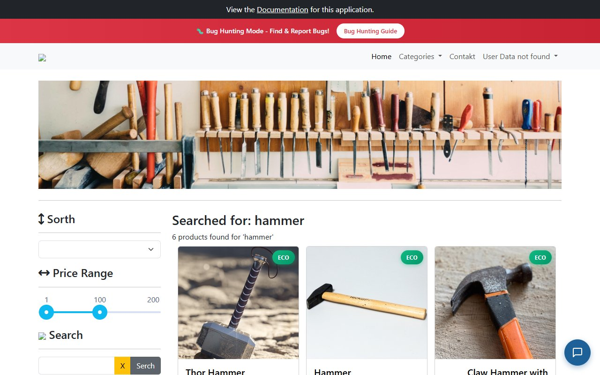

### SESSION REPORT (LAPORAN EKSEKUSI SESI)
* **Tester:** Muhammad Fathoni (R3 - Exploratory Tester)
* **Durasi Sesi:** 30 Menit (Full Session)
* **Waktu Pelaksanaan:** 09:50 - 10:20 WIB
* **Status Sesi:** [X] Selesai Penuh (Full) / [ ] Selesai Sebagian (Partial)

#### DATA UJI & AREA PENJELAJAHAN
* **Target URL:** https://with-bugs.practicesoftwaretesting.com
* **Akun Uji:** 'customer@practicesoftwaretesting.com' / 'welcome01' dan sesi Guest
* **Rute Navigasi:** Beranda (Home) -> Menu Kategori Navbar (Hand Tools, Power Tools, Other) -> Sidebar Multi-Filter (Kategori, Brand, Rentang Harga Slider) -> Kolom Pencarian -> Paginasi Halaman 1 dan 2

#### ANOMALI / BUG YANG DITEMUKAN
1. **[BUG-CHR001-01] Desinkronisasi Status Centang Filter Sidebar dengan Tombol Back Browser (BUG-008)**
   * *Deskripsi:* Penekanan tombol Back peramban setelah menerapkan filter kategori mengembalikan URL ke awal, namun checkbox filter pada sidebar tetap tercentang secara visual dan daftar produk tidak konsisten.
   * *Tautan:* GitHub Issue #8
2. **[BUG-CHR001-02] Kesalahan Ketik (Typo) pada Menu Navigasi Kontak di Header (BUG-001)**
   * *Deskripsi:* Teks link navigasi menuju formulir kontak pada navbar kanan atas tertulis salah sebagai 'Contakt' (seharusnya 'Contact').
   * *Tautan:* GitHub Issue #1

#### PERTANYAAN YANG MUNCUL
* Apakah inkonsistensi filter saat tombol Back ditekan disebabkan ketiadaan sinkronisasi state perutean Angular SPA dengan status checkbox antarmuka?
* Apakah slider rentang harga seharusnya menyediakan opsi input numerik langsung untuk mempermudah aksesibilitas pengguna?

#### HAMBATAN (OBSTACLES)
* Indikator pemuatan (loading spinner) sesekali tidak muncul ketika memilih kombinasi dua filter brand secara berurutan.

#### IDE PENGUJIAN LANJUTAN
* Pengujian kombinasi filter tiga tingkat (Kategori + Brand + Slider Rentang Harga) bersamaan dengan pencarian kata kunci karakter khusus.

#### ESTIMASI RASIO DISTRIBUSI WAKTU
* **Setup (Persiapan lingkungan uji):** 15% (4.5 menit)
* **Eksplorasi Aktif (Proses menjelajah normal):** 65% (19.5 menit)
* **Investigasi Bug (Menelusuri ulang temuan kesalahan):** 20% (6 menit)
* **Total Akumulasi:** 100%

#### LAMPIRAN SCREENSHOT EVIDENCE CAKUPAN CHARTER 1:
1. **Bukti Typo Navbar Contakt (BUG-001):**

2. **Bukti Typo Sort dan Related Products (BUG-002):**

3. **Bukti Typo Tombol Search (BUG-003):**

4. **Bukti Hasil Pencarian Valid Hammer (PASS TC-167):**

5. **Bukti Hasil Pencarian Tidak Ditemukan (PASS TC-168):**

6. **Bukti Filter Kategori Hand Tools Hammer (PASS TC-171):**

7. **Bukti Filter Slider Rentang Harga (PASS TC-172):**

8. **Bukti Pengurutan Nama A-Z (PASS TC-174):**

9. **Bukti Pengurutan Harga Low-High (PASS TC-175):**

10. **Bukti Desinkronisasi Tombol Back Browser (BUG-008):**

11. **Bukti Navigasi Kategori Navbar (PASS TC-190):**

12. **Bukti Navigasi Paginasi Halaman 2 (PASS TC-192):**
