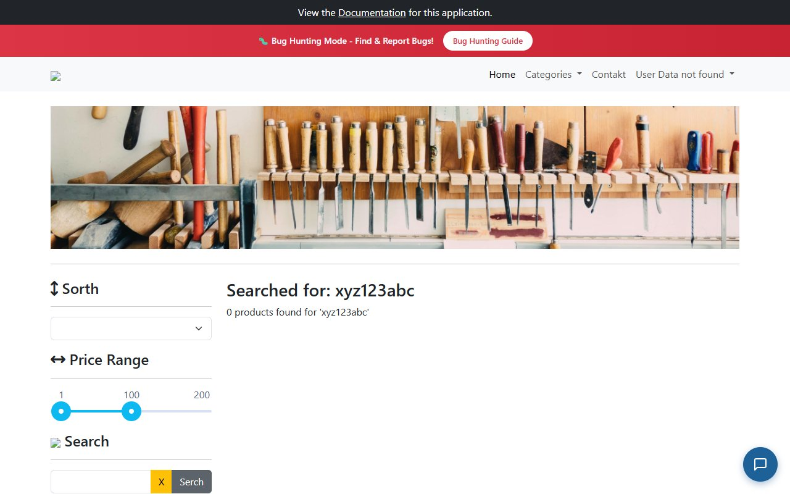
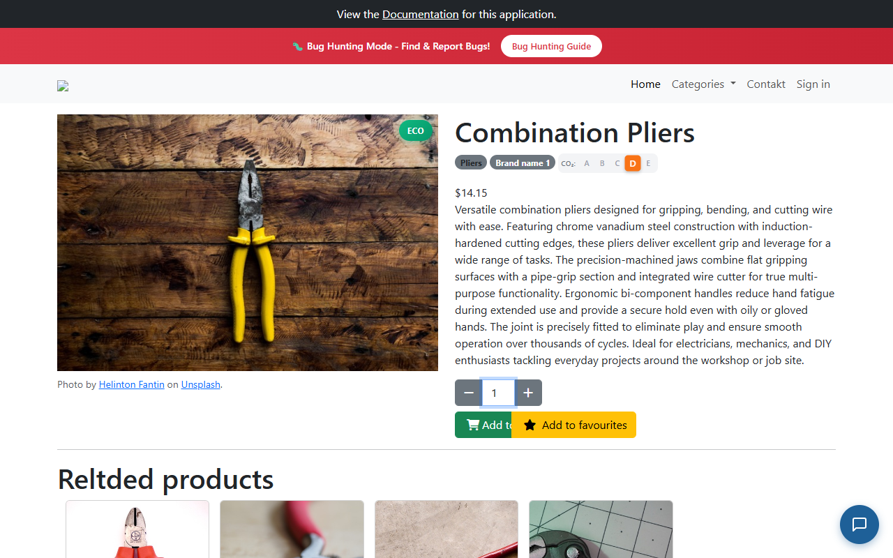
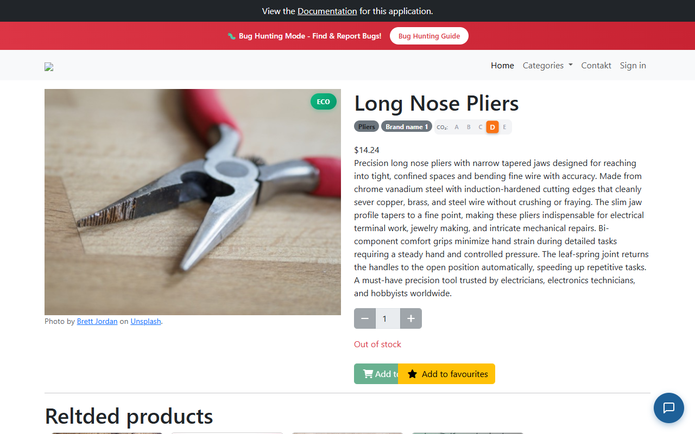
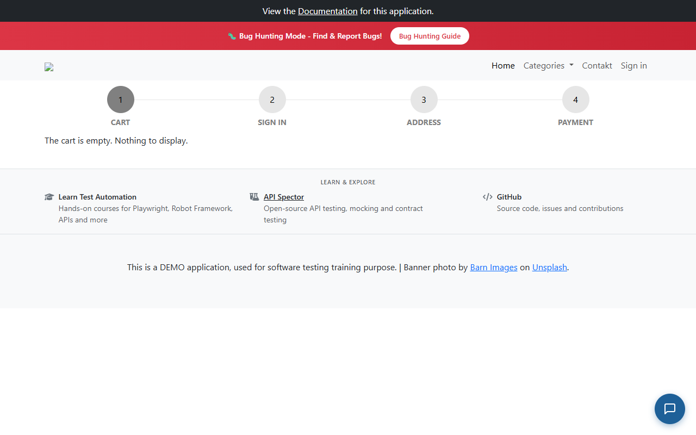
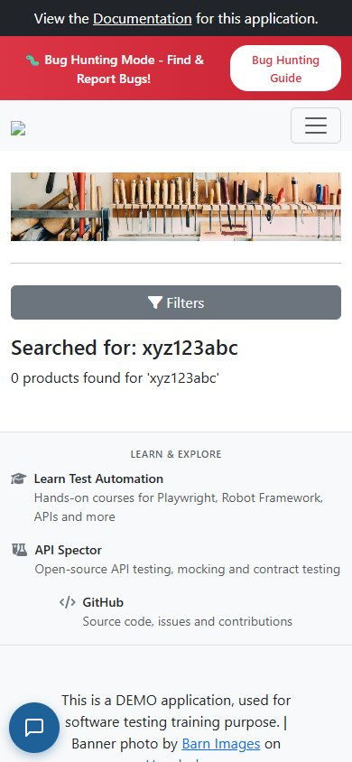
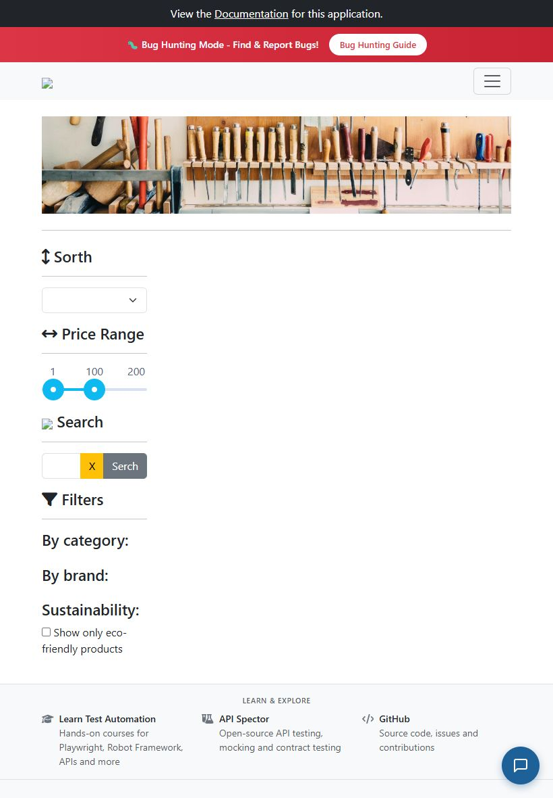
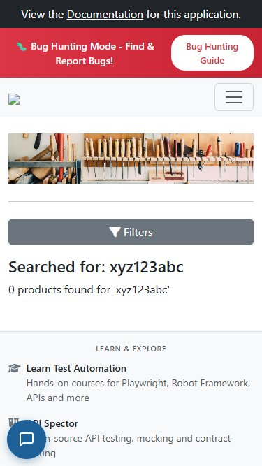
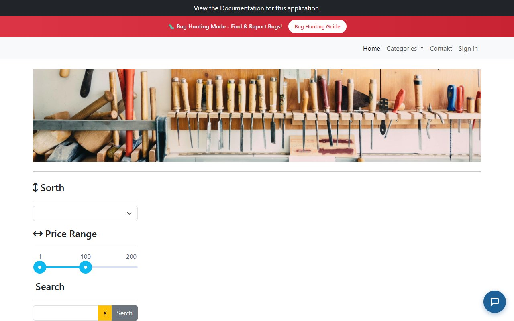

### SESSION REPORT (LAPORAN EKSEKUSI SESI)
* **Tester:** Muhammad Fathoni (R3 - Exploratory Tester)
* **Durasi Sesi:** 30 Menit (Full Session)
* **Waktu Pelaksanaan:** 10:30 - 11:00 WIB
* **Status Sesi:** [X] Selesai Penuh (Full) / [ ] Selesai Sebagian (Partial)

#### DATA UJI & AREA PENJELAJAHAN
* **Target URL:** https://with-bugs.practicesoftwaretesting.com
* **Akun Uji:** 'customer@practicesoftwaretesting.com' / 'welcome01'
* **Rute Navigasi:** Beranda -> Grid Produk Katalog -> Halaman Rincian Produk (Combination Pliers) -> Halaman Produk Out of Stock (Long Nose Pliers) -> Ikon Keranjang Navbar -> Halaman Keranjang & Checkout (#/checkout)

#### ANOMALI / BUG YANG DITEMUKAN
1. **[BUG-CHR002-01] Tombol 'Add to Cart' Tetap Aktif pada Produk Habis Stok / Out of Stock (BUG-006)**
   * *Deskripsi:* Produk dengan status 'Out of stock' (Long Nose Pliers) tombol Add to cart tetap aktif (berwarna biru), dapat diklik, memicu notifikasi sukses, dan produk masuk ke dalam keranjang.
   * *Tautan:* GitHub Issue #6
2. **[BUG-CHR002-02] Input Kuantitas 0 Diizinkan dan Masuk ke Keranjang Belanja (BUG-005)**
   * *Deskripsi:* Field input kuantitas menerima angka 0 dan sistem mengizinkan produk dengan kuantitas 0 ditambahkan ke keranjang belanja tanpa validasi batas bawah.
   * *Tautan:* GitHub Issue #5

#### PERTANYAAN YANG MUNCUL
* Mengapa kontrol kuantitas tidak memiliki atribut min="1" di elemen input HTML sisi antarmuka?
* Apakah proses penambahan barang ke keranjang telah memverifikasi ketersediaan stok riil di sisi basis data backend?

#### HAMBATAN (OBSTACLES)
* Tidak ada.

#### IDE PENGUJIAN LANJUTAN
* Uji coba transaksi pembayaran penuh (Checkout Steps 1 sampai 4) dengan item kuantitas 0 dan kuantitas negatif untuk mengamati respons gateway pembayaran.

#### ESTIMASI RASIO DISTRIBUSI WAKTU
* **Setup (Persiapan lingkungan uji):** 10% (3 menit)
* **Eksplorasi Aktif (Proses menjelajah normal):** 70% (21 menit)
* **Investigasi Bug (Menelusuri ulang temuan kesalahan):** 20% (6 menit)
* **Total Akumulasi:** 100%

#### LAMPIRAN SCREENSHOT EVIDENCE CAKUPAN CHARTER 2:
1. **Bukti Alur Navigasi Produk ke Halaman Detail (PASS TC-195):**

2. **Bukti Cacat Kuantitas 0 pada Detail Produk (BUG-005):**

3. **Bukti Cacat Produk Out of Stock Bisa Dibeli (BUG-006):**

4. **Bukti Cacat Double Click Menghasilkan Item Duplikat (BUG-007):**

5. **Bukti Responsivitas Mobile iPhone SE (PASS TC-199):**

6. **Bukti Responsivitas Smartphone Standar (PASS TC-200):**

7. **Bukti Responsivitas Tablet iPad (PASS TC-201):**

8. **Bukti Alur Checkout pada Viewport Tersempit (PASS TC-202):**

9. **Bukti Cacat Aksesibilitas Low Contrast Detail Produk (BUG-009):**

10. **Bukti Cacat Aksesibilitas Missing Form Labels (BUG-010):**
